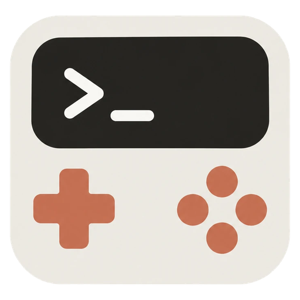

<p align="center">
  
</p>

<h1 align="center">Gamemods: games for Claude Code</h1>

Play games in Claude Code while Claude works. Gamemods is a Claude Code mod (plugin): a game menu in the band above the prompt, each game in a side pane. It works in the terminal and in Desktop. Every key is answered locally: zero model calls, zero tokens, nothing added to the conversation.

<video src="assets/gamemods.mp4" controls muted loop width="100%"></video>

## Games

The Claude Code game mods available today. Rules, keys and score of each game are in its README.

| Game                                           | What                                             | Surfaces          |
| :--------------------------------------------- | :----------------------------------------------- | :---------------- |
| [Tic-tac-toe](src/games/tic-tac-toe/README.md) | Three in a row against a bot                     | Desktop, terminal |
| [Hogzzle](src/games/hogzzle/README.md)         | Swap the tiles until PostHog's hedgehog is whole | Desktop           |
| [Echo](src/games/echo/README.md)               | Repeat a growing sequence of lit cells           | Desktop, terminal |
| [2048](src/games/2048/README.md)               | Slide and merge the tiles until one reaches 2048 | Desktop, terminal |

## A side project, for fun

Gamemods started as a way to try Claude Code mods and to have a good time doing it. It is not a productivity tool and it does not take itself too seriously: think of it as an arcade cabinet for Claude, where you play a round while Claude works. It feels good to ship something fun next to the everyday grind.

The cabinet is meant to fill up. If you have a game in mind, add it: a game is a small pure module, and [docs/ADD_A_GAME.md](docs/ADD_A_GAME.md) walks you through it. Not sure yet? Open a [game proposal](https://github.com/Birium/gamemods/issues/new?template=game_proposal.yml) and let's talk.

## Requirements

- Claude Code 2.1.287 or later (mods are on by default from that version).
- A local session in the Code tab of Claude Code Desktop, or in a terminal.

## Install

From a terminal:

```bash
claude plugin marketplace add Birium/gamemods
```

```bash
claude plugin install gamemods@gamemods
```

Or inside a Claude Code session: `/plugin marketplace add Birium/gamemods`, then `/plugin install gamemods@gamemods`. In Desktop: **+** next to the prompt, **Plugins**, **Add plugin**. Desktop and terminal share the same settings, so one install covers both.

## Play

- **Open the menu:** press **Games** on the `GAMEMODS` line above the prompt (click, or Tab then Enter), or type `/gamemods`.
- **Start a game:** pick it in the menu, or type `/gamemods <game>` (`/gamemods tic-tac-toe`). `/gamemods stop` closes the pane.
- **Give it the keyboard:** on Desktop, click inside the pane once.

Every game has these keys; its own are in its README.

| Key | Action                |
| :-- | :-------------------- |
| `p` | Pause or resume       |
| `r` | Restart               |
| `q` | Back to the game menu |

The game pauses on its own when Claude asks for a permission, when Claude finishes its turn, and when the pane loses the keyboard. It never resumes by itself: press `p`.

Each game has its own score, described in its README. The best score of each game is kept across sessions.

## Limitations

- Nothing is drawn in Desktop WSL sessions, the VS Code chat panel, `claude -p` or cloud sessions.
- On Desktop, `/gamemods` typed during a turn waits for the turn to end. During a turn, use the **Games** button instead.
- Tested on Claude Code Desktop 2.19675.0 and terminal 2.1.288. A newer build can behave differently.

## Contributing

- [CONTRIBUTING.md](CONTRIBUTING.md): dev loop, checks, manual test protocol.
- [docs/ARCHITECTURE.md](docs/ARCHITECTURE.md): how the mod is built.
- [docs/ADD_A_GAME.md](docs/ADD_A_GAME.md): add a game, new games are very welcome.

Security issues: [SECURITY.md](SECURITY.md).

## License

[MIT](LICENSE) © Birium

Hogzzle's pictures are © PostHog, used unmodified and not covered by this license: see [Hogzzle → Pictures](src/games/hogzzle/README.md#pictures).

Gamemods is an independent project, not affiliated with or endorsed by Anthropic. Claude and Claude Code are trademarks of Anthropic.

If you had fun, leave a star on the repo: it is the cheapest way to say thanks, and it helps other people find the project.
